  
  
  

I build React and TypeScript interfaces and the Node.js services behind them. At **Techbase** I worked on 3CX Nexus, a platform for managing many 3CX VoIP instances from one place, where caching and request optimisation cut external API load by **40%**.

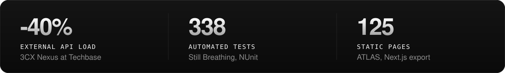

Outside work I'm a curious and creative person, and I love diving into projects I find interesting. Here's what I'm currently working on:

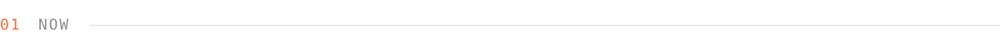
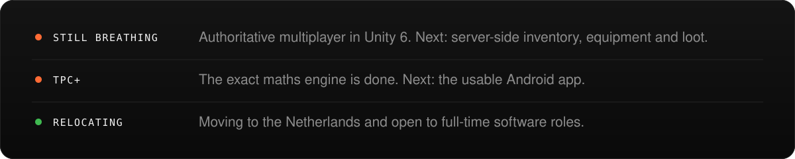

 
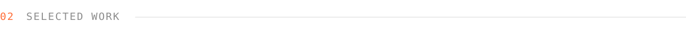

<a href="https://github.com/WHAIT666/tpc-plus">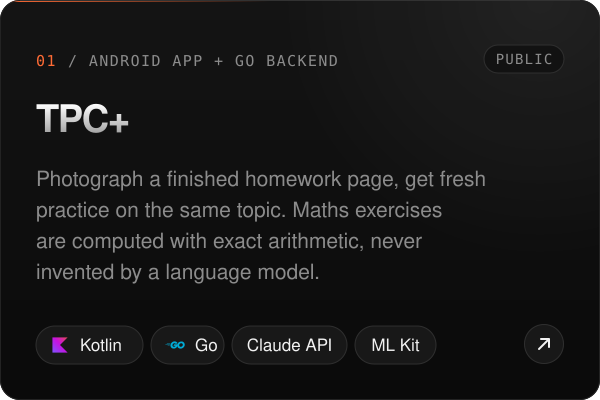</a> 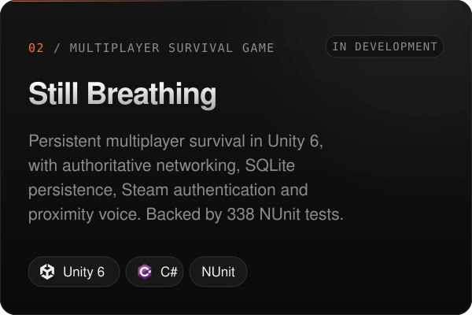
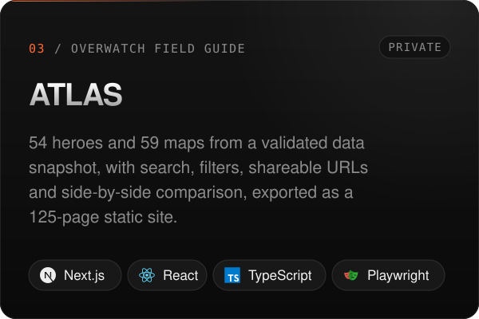 <a href="https://github.com/WHAIT666/cpp-discord-rich-presence">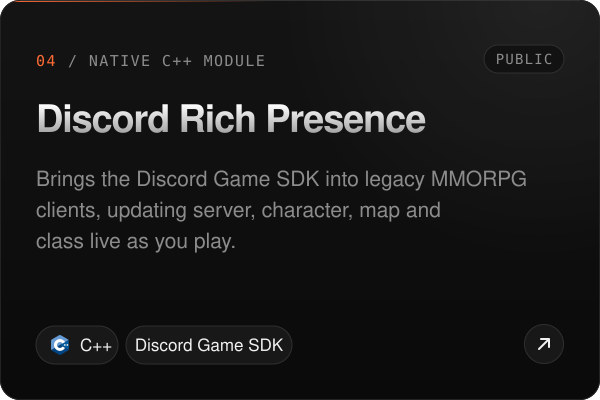</a>

 
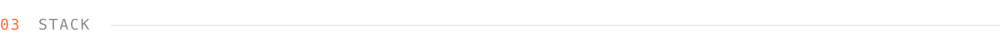
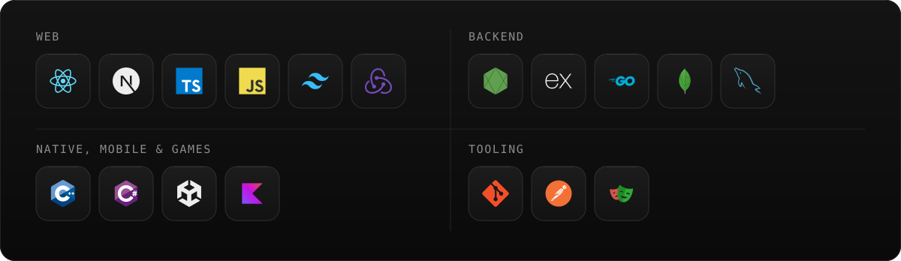

 
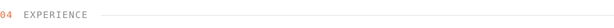
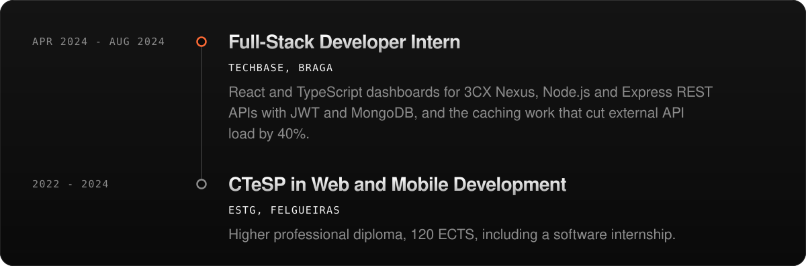
